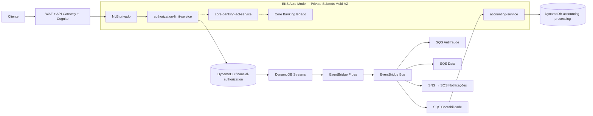

# POD99 — Apresentação AWS (implementação do case)

**Escopo:** estudo técnico de arquitetura para Gestão de Limites e Autorização de Transações, do enunciado POD99/Itaú; **não é uma implementação oficial da instituição**.

**Status:** código e Terraform publicados; recursos AWS **não provisionados**. Testes automatizados precisam ser verificados em GitHub Actions. **5.000 TPS é pico exigido, não desempenho comprovado.**

## Por que o Itaú ganha com esta arquitetura?

O banco obtém uma **fronteira ACID de autorização e reserva** que impede consumo duplo de limite e suporta replays por chave idempotente, mantendo contabilidade e antifraude fora do tempo de resposta síncrono. As filas por domínio permitem recuperação e evolução independente. Há riscos reais: custo transacional, hot keys por contrato, reordenação/duplicidade, 24h de Streams e operação de EKS. Consulte [prós e contras](docs/negocio/valor-para-o-itau.md).

## Hierarquia de arquitetura: BIAN → DDD → microsserviços → banco

| Referência BIAN | Bounded Context do projeto | Microsserviço | Persistência / observação |
|---|---|---|---|
| Transaction Authorization, aspectos de Position Keeping | `AuthorizationAndLimitReservation` (módulos Authorization e Contract Limits) | [authorization-limit-service](services/authorization-limit-service) | DynamoDB `financial-authorization`; invariante ACID e Outbox |
| Financial Accounting | `AccountingIntegration` | [accounting-service](services/accounting-service) | DynamoDB `accounting-processing`; Inbox/deduplicação, **não lança no razão** |
| Current Account/Consumer Loan conforme produto | `CoreBankingIntegration` | [core-banking-acl-service](services/core-banking-acl-service) | Stateless; perfil demo claramente simulado |

**Service Domain BIAN não equivale obrigatoriamente a um microsserviço.**

## Fluxo da solução



[**Abrir o diagrama AWS oficial, detalhado e editável em Draw.io**](diagramas/pod99-integracao-aws.drawio) — páginas C4 Container e sequência da transação.

## Código e arquitetura

- **Java 17 + Spring Boot 3.4** (três serviços, build Maven independente);
- **DDD**: `ContractLimit` agregado, `Money` Value Object, `OperationType`, `Authorization`;
- **Clean/Hexagonal**: API adapter / Application Use Case / Domain / Outbound Port / DynamoDB Adapter;
- **SOLID**: consulte [design e regras](docs/arquitetura/contratos-integracoes.md) e testes de domínio;
- **Idempotência**: UUID e hash de payload gravados em `IDEMPOTENCY`; replay de aprovação retorna 200;
- **Concorrência**: `TransactWriteItems`, versão do agregado, condição otimista, 4 escritas (5 para ESTORNO);
- **Outbox** no mesmo commit; **Streams → Pipes → EventBridge → SQS** depois do commit;
- **Contrato**: [OpenAPI 3.x](contracts/openapi/authorization-v1.yaml) e [AsyncAPI/CloudEvents](contracts/asyncapi/financial-events-v1.yaml);
- **Terraform**: `terraform/plataforma` (EKS Auto Mode, VPC, DDB, Streams, Pipes, SQS/SNS, WAF, API GW, Cognito, IAM, ECR) e `terraform/workloads` (deploys, NLB, HPA, PDB).

## Demo sem custos AWS

Requer Docker e Docker Compose:

```bash
cd apresentação-aws
docker compose up --build
# em outro terminal
bash scripts/demo-concorrencia.sh
```

- DynamoDB Local inicia com `contrato-demo` / `conta-demo`, limite disponível R$ 7.000.
- REST API local: `http://localhost:8080/v1/contratos/contrato-demo/autorizacoes`.
- ACL de demonstração: `http://localhost:8082/internal/contracts/contrato-demo`.
- Conta contábil no Compose inicia **sem fila**; o caminho AWS Streams/Pipes/EventBridge não é emulado em Docker Compose.
- `docker compose down` limpa a demo. Banco local é em memória; reiniciar recria limite original.

## Deploy Terraform — **não aplicar automaticamente**

1. `terraform -chdir=terraform/plataforma init && terraform -chdir=terraform/plataforma plan`.
2. Revisar IAM, WAF, despesas NAT Multi-AZ, EKS Auto Mode, DynamoDB on-demand, EventBridge/SQS.
3. **Se autorizado**, apply da plataforma; publicar três imagens em ECR usando `scripts/publish-ecr.sh`.
4. Aplicar `terraform/workloads` com as URIs imutáveis do ECR.
5. Depois da criação do NLB interno, habilitar o módulo `edge` da plataforma com NLB ARN + DNS e aplicar novamente.
6. Configurar usuário Cognito/JWT; verificar health, 201/200/402/409/422, Outbox e DLQs.

## Riscos e pendências de produção

Esta é uma **prova de arquitetura**, não uma autorização para colocar operações reais de clientes no banco. Estão pendentes: integração com core real, ciclo bancário homologado de CRÉDITO/DÉBITO/ESTORNO, reconciliação durável >24h (além da Outbox), contabilidade real, tuning WAF/JWT, teste real de 5.000 TPS, custos, RTO/RPO e políticas regulatórias. **Zero deploy e zero custo AWS nesta entrega.**

## Documentação

- [Ganho de negócio, prós e contras](docs/negocio/valor-para-o-itau.md)
- [Integrações e responsabilidades](docs/arquitetura/contratos-integracoes.md)
- [BIAN e hierarquia dos microsserviços](docs/arquitetura/tabelas-hierarquia-bian-ddd-aws.md)
- [Arquitetura editável AWS](diagramas/README.md)
- [ADR-001 da baseline](docs/adr/ADR-001-dynamodb-streams-eventbridge.md)
- [ADR-002 por bounded context](docs/adr/ADR-002-banco-por-bounded-context.md)
- [FinOps](docs/finops/estimativa-custos.md)
- [Status do MVP e próximos passos](docs/implementacao/status-mvp.md)
