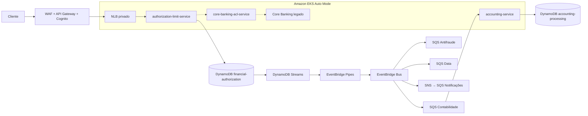

# Diagrama de Integração — AWS oficiais (Draw.io)

**Arquivo editável:** [pod99-integracao-aws.drawio](pod99-integracao-aws.drawio)  
Abrir em [diagrams.net](https://app.diagrams.net/) → File → Open from → GitHub ou Device.

Este desenho utiliza shapes de arquitetura AWS4 do Draw.io, **não substitutos estilizados**:

`shape=mxgraph.aws4.resourceIcon;resIcon=mxgraph.aws4.eks`, `dynamodb`, `eventbridge`, `sqs`, `sns`, `api_gateway`, `waf`, `cognito`, `cloudwatch` e `iam`.

## Leituras

- **Página 1:** C4 Container com componentes AWS, 3 serviços, 2 tabelas DynamoDB, Streams/Pipes/EventBridge, NLB + API Gateway, BIAN e integração legada.
- **Página 2:** sequência de reserva / outbox / eventual consistency.
- **Azul:** chamada síncrona. **Laranja tracejado:** transporte assíncrono. **Cinza tracejado:** segurança/observabilidade/contratos.
- **NLB:** provisionado pelo EKS Auto Mode depois da fase workloads. A API Gateway REST é aplicada numa segunda passagem do Terraform de plataforma.
- **Limite de consistência:** transação só entre itens DynamoDB do authorization-limit-service. Fila/contabilidade operam após o commit.
- **Dependências não concluídas:** core bancário externo real, reconciliador Outbox >24h, telemetria completa, testes de produção e liquidação contábil.

**Identificadores de ícones AWS4 do Draw.io:** https://github.com/jgraph/drawio/blob/dev/src/main/webapp/js/diagramly/sidebar/Sidebar-AWS4.js

## Arquitetura complementar renderizada diretamente no GitHub

