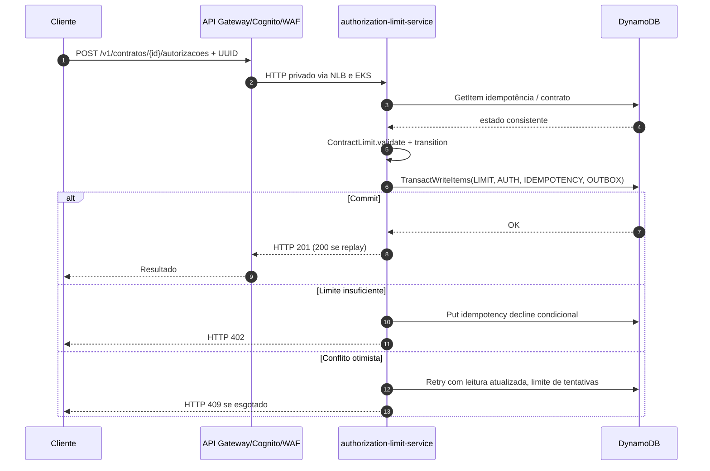
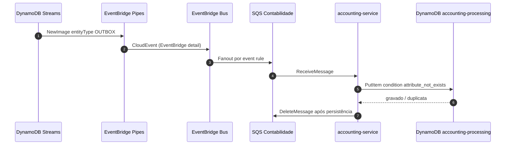

# Integrações entre bounded contexts, microsserviços e AWS

O desenho detalhado com ícones AWS4 está em [Draw.io](../../diagramas/pod99-integracao-aws.drawio).

| Microserviço | Bounded Context (nosso) | Referência BIAN v14 | Comando/assinatura | Persistência |
|---|---|---|---|---|
| authorization-limit-service | AuthorizationAndLimitReservation: módulos Authorization e Contract Limits | Transaction Authorization e aspectos de Position Keeping | POST autorização; TransactWriteItems | DynamoDB financial-authorization |
| core-banking-acl-service | CoreBankingIntegration | Current Account/Consumer Loan conforme contrato | GET normalizado de contrato (demo/stub) | Sem banco próprio |
| accounting-service | AccountingIntegration | Financial Accounting | SQS inbox; dedup event_id | DynamoDB accounting-processing |
| Futuro consumer fraude | FraudEvaluationIntegration | Fraud Evaluation | SQS pós-autorização | Fora do MVP |

## Síncrono — cliente até commit

A transação completa é **somente local no DynamoDB**, no domínio que possui o limite. A disponibilidade financeira e a autorização nunca dependem de uma confirmação EventBridge.

## Assíncrono — evento depois do commit

- Streams apenas 24 horas, precisa recuperação após falha prolongada.
- Mensageria e consumidores **at-least-once**: duplicação/reordenação sempre possível.
- Contratos publicados em `contracts/openapi` e `contracts/asyncapi`; o registry é governança, não validação automática de todo evento.
- SQS DLQ de cada consumidor e alarmes. SNS é usado como fan-out adicional de notificações.
- O EventBridge Pipes transforma os atributos Outbox num evento CloudEvents cujo conteúdo aparece em `detail`.

## Definição das operações (hipóteses do MVP)

| Operação | Alterações no agregado | Evento |
|---|---|---|
| RESERVA | available→reserved | TransacaoAutorizada |
| DEBITO | available→used | TransacaoAutorizada |
| CREDITO | used→available | LimiteAlterado |
| ESTORNO | Reverte RESERVA ou DEBITO, apenas uma vez | TransacaoEstornada |

**Essas transições são convenções implementadas para demonstrar consistência**, não regras oficialmente confirmadas pelo Itaú. `id_autorizacao_original` é a extensão proposta para ESTORNO. As regras de produto, ciclo contábil e integração ao core exigem refinamento antes de uso real.

## Contexto ACL

A camada anticorrupção transforma `Current Account` e condições de contrato de sistemas legados em modelo de domínio normalizado, impedindo acoplamento do núcleo a formatos do core. O serviço está em modo `demo` local; não é chamado no caminho crítico ainda para não inventar contratos ou SLA do core.

## Segurança e Well-Architected

Entrada WAF/Cognito/API Gateway REST, VPC Link com NLB privado, EKS Auto Mode multi-AZ, Pod Identity e IAM de privilégio mínimo, DynamoDB PITR, filas criptografadas e CloudWatch alarms/logs. A solução completa inclui também ADRs de bancos, custo, monitoramento e carga, mas não houve teste AWS real.
